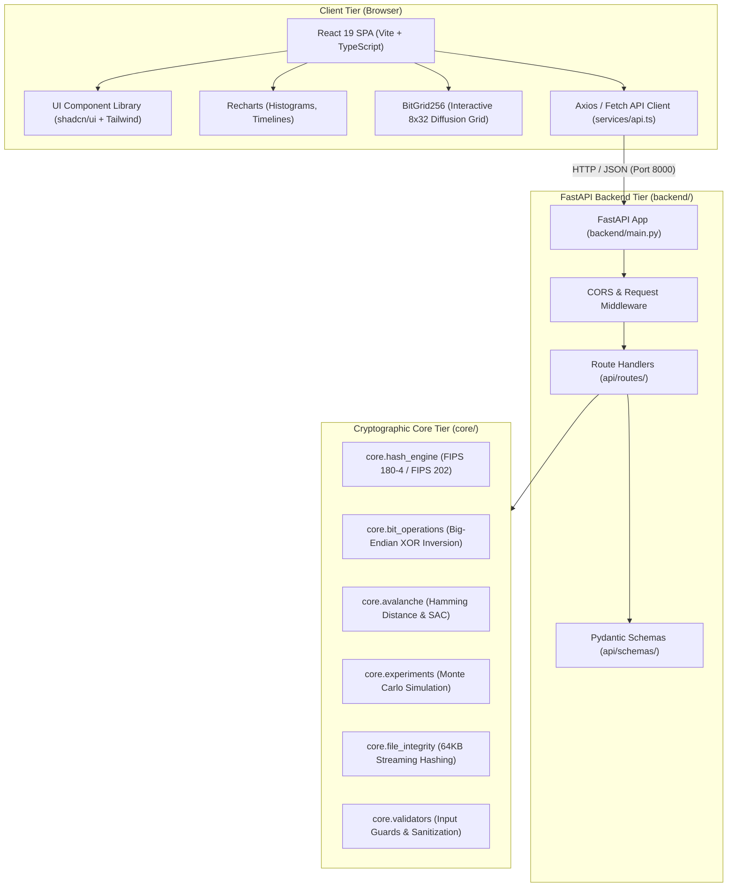
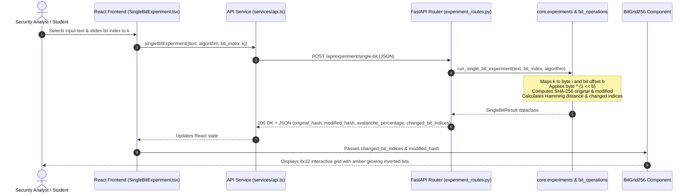

# HashForge: Full-Stack Architecture Specification

## 1. Architectural Overview

HashForge is engineered as a decoupled, multi-tier cryptographic educational and visualization platform. The system separates mathematical computation, API exposition, and user presentation into distinct layers:

1. **Frontend Presentation Tier (`frontend/`):** A modern React 19 Single Page Application (SPA) built with TypeScript, Vite, Tailwind CSS, Lucide React, and Recharts.
2. **API Orchestration Tier (`backend/`):** A high-throughput FastAPI asynchronous REST service that validates inputs with Pydantic v2 schemas and dispatches requests to the core engine.
3. **Core Cryptographic Engine (`core/`):** A zero-external-dependency, FIPS-compliant Python module utilizing `hashlib` for SHA-256 and SHA3-256, big-endian network bit manipulation, and Monte Carlo statistics.

---

## 2. Directory Layout & Module Responsibilities

### 2.1 Frontend Tier (`frontend/`)

- `src/main.tsx` & `src/App.tsx`: Application bootstrap, routing configuration, and layout wrappers.
- `src/pages/`:
  - `Dashboard.tsx`: Executive system dashboard with platform metrics, feature cards, and quick navigation.
  - `HashGenerator.tsx`: Real-time dual SHA-256 and SHA3-256 calculation with chunked hex/binary outputs and report export.
  - `AlgorithmLab.tsx`: Merkle-Damgård vs Sponge comparison, cross-algorithm divergence, and execution benchmarks.
  - `SingleBitExperiment.tsx`: Interactive bit-flip slider, input bit inspection, and 256-bit glowing diffusion grid.
  - `MultiBitExperiment.tsx`: Multi-bit perturbation with random sampling, manual indices, and seed reproducibility.
  - `AvalancheAnalyzer.tsx`: Monte Carlo simulation runner with Recharts histograms, trial dispersion charts, and CSV export.
  - `FileIntegrity.tsx`: Single file fingerprinting, two-file comparison, and vendor reference verification.
  - `LearningCenter.tsx`: 12-topic curriculum and interactive 10-question evaluation quiz with instant grading.
- `src/components/`:
  - `layout/`: `Sidebar.tsx` (collapsible navigation with zero emojis), `TopHeader.tsx` (breadcrumbs, health status indicator), `AppShell.tsx`.
  - `binary/`: `BitGrid256.tsx` (8 rows of 32 bits with hover tooltips and glowing amber flip states), `BinaryStreamViewer.tsx`.
  - `charts/`: `AvalancheHistogram.tsx`, `TrialTimelineChart.tsx`, `AlgorithmComparisonBox.tsx`.
  - `shared/`: `MetricCard.tsx`, `StatusBadge.tsx`, `HashBox.tsx`.
- `src/services/api.ts`: Centralized HTTP service interfacing with backend endpoints.
- `src/types/index.ts`: TypeScript definitions mapping backend Pydantic schemas.

### 2.2 Backend API Tier (`backend/`)

- `main.py`: FastAPI initialization, CORS middleware configuration (ports 5173, 3000, 8000), route mounting, and exception handling.
- `api/routes/`:
  - `hash_routes.py`: Endpoints for single hash generation, dual algorithm comparison, and timing benchmarks.
  - `experiment_routes.py`: Single-bit and multi-bit perturbation endpoints.
  - `avalanche_routes.py`: High-volume Monte Carlo avalanche simulation endpoint.
  - `file_routes.py`: Streaming multipart file hashing and comparison endpoints.
  - `health_routes.py`: Liveness and readiness health check endpoint (`/api/health`).
- `api/schemas/`:
  - `hash_schemas.py`: Request and response models for hash computations.
  - `experiment_schemas.py`: Schemas for bit flipping and avalanche outputs.
  - `avalanche_schemas.py`: Schemas for Monte Carlo trial parameters and summary statistics.
  - `file_schemas.py`: Schemas for file comparison results.

### 2.3 Core Cryptographic Engine (`core/`)

- Decoupled from both Streamlit and FastAPI (zero web framework imports).
- Pure, deterministic, and testable:
  - `hash_engine.py`: Encapsulates `hashlib.sha256` and `hashlib.sha3_256`, high-resolution timing via `time.perf_counter_ns()`, and hex/binary transformations.
  - `bit_operations.py`: Enforces Big-Endian network bit indexing ($i = \lfloor k/8 \rfloor$, $b = 7 - (k \bmod 8)$) and implements XOR inversion (`byte ^ (1 << b)`).
  - `avalanche.py`: Calculates Hamming distance, avalanche percentage, and difference masks.
  - `experiments.py`: Manages single-bit, multi-bit, and high-sample Monte Carlo simulations with optional RNG seed control.
  - `file_integrity.py`: Implements memory-efficient chunked streaming (`64KB` buffers) for file fingerprinting and parity verification.
  - `validators.py`: Input guardrails ensuring bounded memory allocation and valid bit ranges.

---

## 3. Backend REST API Specification

| Endpoint | Method | Request Schema | Response Schema | Description |
|---|:---:|---|---|---|
| `/api/health` | GET | None | `HealthResponse` | Service health status and timestamp. |
| `/api/hash/compute` | POST | `HashRequest` | `HashResponse` | Computes SHA-256 or SHA3-256 with hex and binary digests. |
| `/api/hash/dual` | POST | `DualHashRequest` | `DualHashResponse` | Computes both algorithms simultaneously with cross-divergence. |
| `/api/hash/benchmark` | POST | `BenchmarkRequest` | `BenchmarkResponse` | Executes local latency benchmark over $N$ iterations. |
| `/api/experiment/single-bit` | POST | `SingleBitExperimentRequest` | `SingleBitExperimentResponse` | Inverts bit $k$ and returns avalanche metrics + 256-bit diff mask. |
| `/api/experiment/multi-bit` | POST | `MultiBitExperimentRequest` | `MultiBitExperimentResponse` | Inverts multiple bits (manual or random) and returns metrics. |
| `/api/avalanche/simulate` | POST | `AvalancheSimulateRequest` | `AvalancheSimulateResponse` | Executes Monte Carlo simulation over $N$ trials with stats. |
| `/api/file/hash` | POST | `UploadFile` (multipart) | `FileHashResponse` | Computes 64KB chunked hashes of an uploaded file. |
| `/api/file/compare` | POST | Two `UploadFile`s | `FileCompareResponse` | Compares two files byte-by-byte for parity and tamper detection. |

---

## 4. Cryptographic Invariants & Standards

### 4.1 Big-Endian Network Bit Indexing Standard
For a byte sequence $B = [b_0, b_1, \dots, b_{N-1}]$ where $b_i \in \{0, \dots, 255\}$, any addressable bit $k \in \{0, \dots, 8N - 1\}$ maps to:
$$i = \lfloor k / 8 \rfloor, \quad b = 7 - (k \bmod 8)$$
Bitwise XOR inversion is applied directly to the byte at offset $i$:
$$b_i' = b_i \oplus (1 \ll b)$$
- **Bit 0:** Most Significant Bit (MSB, mask `0x80`) of Byte 0.
- **Bit 7:** Least Significant Bit (LSB, mask `0x01`) of Byte 0.
- **Bit 8:** MSB (mask `0x80`) of Byte 1.

### 4.2 Strict Avalanche Criterion (SAC) Verification
For two 256-bit binary hash digests $H_1, H_2 \in \{0, 1\}^{256}$:
- **Hamming Distance:** $D(H_1, H_2) = \sum_{j=0}^{255} (H_1[j] \oplus H_2[j])$
- **Avalanche Percentage:** $\text{Avalanche } \% = \frac{D(H_1, H_2)}{256} \times 100\%$
- **Theoretical Mean:** $\mu = 128 \text{ bits } (50.00\%)$
- **Theoretical Standard Deviation:** $\sigma = \sqrt{256 \times 0.5 \times 0.5} = 8.0 \text{ bits } (3.125\%)$

### 4.3 Streaming I/O Buffer
All file hashing operations process streams in $64\text{ KB}$ ($65,536\text{ bytes}$) buffer chunks, preventing memory spikes when hashing multi-megabyte files.

---

## 5. End-to-End Data Flow Sequence

---

## 6. Design System & UI Specifications

The React frontend implements a high-density, dark-first cybersecurity design system:
- **Background Base:** `#0B0F17` (Deep space canvas)
- **Sidebar Surface:** `#0D1420` (Tactical navy sidebar)
- **Card Surface:** `#111827` (Card containers)
- **Elevated Surface:** `#172033` (Dropdowns, modals, and hover states)
- **Border Trim:** `#253247` (Precision subtle separators)
- **Accent Cyan:** `#00D6C9` (Primary brand accent and SHA-256 indicators)
- **Accent Emerald:** `#10B981` (Verification success and SHA3-256 indicators)
- **Accent Amber:** `#F59E0B` (Flipped bit indicators and warnings)
- **Accent Rose:** `#EF4444` (Tamper alerts and errors)
- **Typography:** `Inter` for general interface elements, `JetBrains Mono` for cryptographic hashes and binary sequences.
- **Strict Iconography:** Exclusive use of SVG icons from `lucide-react` — zero emojis in UI.
