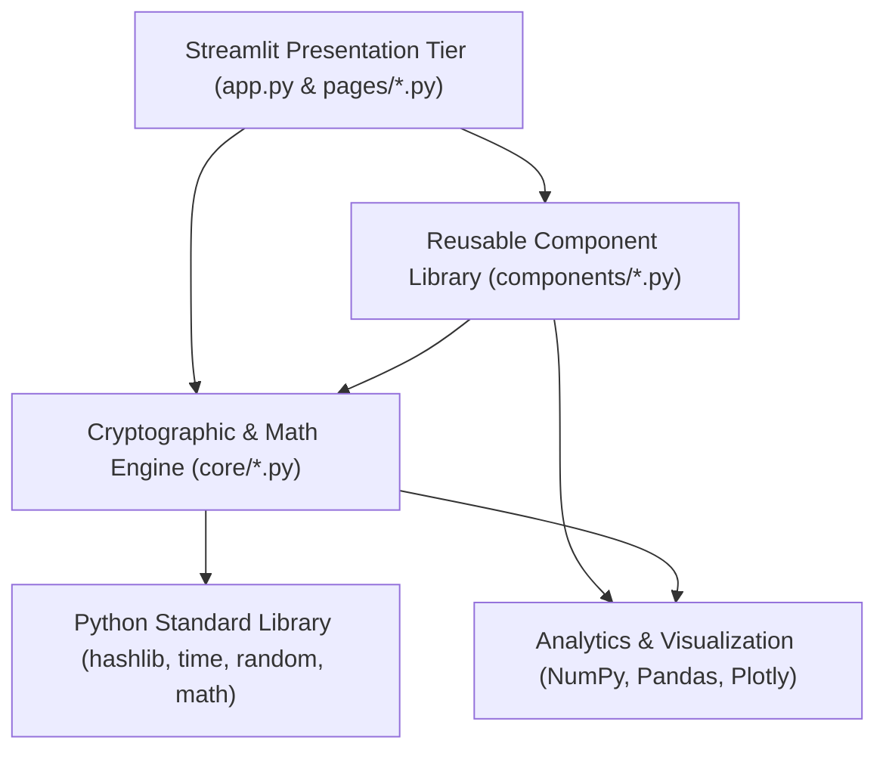
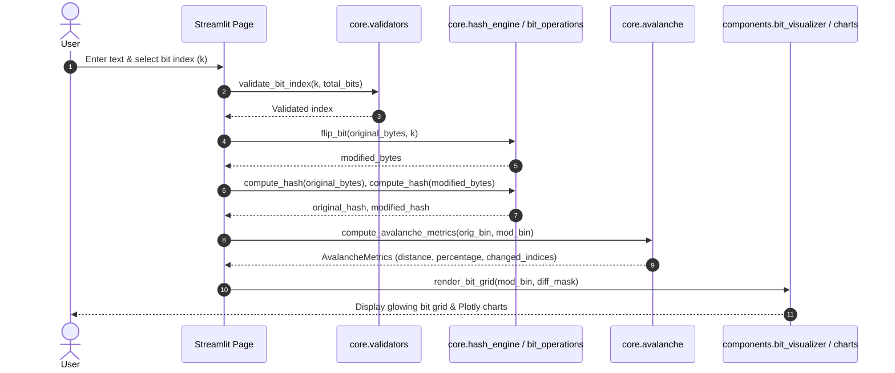

# HashForge: Architecture Specification

## 1. Architectural Overview

HashForge follows a **Layered Modular Architecture** that strictly decouples cryptographic mathematics and operational algorithms from the Streamlit presentation tier.

---

## 2. Directory Layout & Layer Responsibilities

### 2.1 The Core Engine (`core/`)
- Completely decoupled from Streamlit: does not import `streamlit`.
- All functions are pure, deterministic, and easily testable via automated scripts.
- Modules:
  - `hash_engine.py`: Encapsulates `hashlib.sha256` and `hashlib.sha3_256`, high-resolution timing via `time.perf_counter_ns()`, and hex/binary transformations.
  - `bit_operations.py`: Enforces Big-Endian network bit indexing ($i = \lfloor k/8 \rfloor$, $b = 7 - (k \bmod 8)$) and implements XOR inversion (`byte ^ (1 << b)`).
  - `avalanche.py`: Calculates Hamming distance, avalanche percentage, and difference masks.
  - `experiments.py`: Manages single-bit, multi-bit, and high-sample Monte Carlo simulations with optional RNG seed control.
  - `file_integrity.py`: Implements memory-efficient chunked streaming (`64KB` buffers) for file fingerprinting and parity verification.
  - `validators.py`: Input guardrails ensuring bounded memory allocation and valid bit ranges.

### 2.2 The Component Layer (`components/`)
- Reusable UI elements:
  - `sidebar.py`: Injects `assets/custom.css` and renders persistent branding and specifications.
  - `metric_cards.py`: Styled HTML/CSS metric cards.
  - `bit_visualizer.py`: Formats 256 output bits into an 8-row by 32-bit responsive grid with glowing diff highlights.
  - `hash_display.py`: Formatted hexadecimal and binary output widgets with copy actions.
  - `comparison.py`: Side-by-side cryptographic comparison tables.
  - `charts.py`: Plotly interactive histograms, scatter lines, and boxplots configured with the dark theme.

### 2.3 The Presentation Layer (`app.py` & `pages/`)
- Built using Streamlit's multi-page directory routing (`pages/`).
- Handles user inputs, session state management, file uploads, and page rendering.

---

## 3. Data Flow Model

---

## 4. Design Invariants & Standards

1. **No External APIs:** The application operates 100% locally.
2. **Immutable Transformations:** Flipping bits returns a new `bytes` instance rather than modifying data in place.
3. **Big-Endian Bit Indexing:** Standardized network bit order is strictly maintained across all modules and tests.
4. **Streaming File I/O:** Uploaded files are read in 64KB increments to keep memory consumption low.

