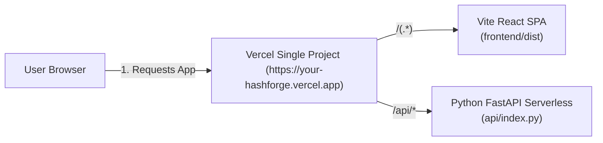

# HashForge: Production Deployment Guide

HashForge supports two deployment models:
1. **All-in-One Vercel Deployment (Recommended):** Both React frontend and FastAPI backend deployed together on **Vercel** under a single domain.
2. **Split Deployment (Alternative):** FastAPI backend on **Render** (persistent container) + React frontend on **Vercel** (static edge).

---

## METHOD 1: All-in-One Vercel Deployment (Recommended)

Vercel natively supports **Python Serverless Functions** alongside **Vite Static Builds**. The repository has been pre-configured with:
- [`api/index.py`](../api/index.py): Vercel Python serverless function entrypoint for FastAPI.
- [`vercel.json`](../vercel.json): Unified build command and rewrites routing `/api/*` to FastAPI and all other routes to React.
- [`requirements.txt`](../requirements.txt): Python dependencies for serverless execution.



### Advantages of All-in-One Vercel Deployment
- **Zero CORS Issues:** Frontend and API share the exact same domain.
- **Zero Environment Variables Required:** Frontend defaults to relative `/api` paths.
- **Single Git Push:** Pushing to GitHub triggers automatic preview and production deployments for both tiers.
- **Cost:** 100% free on Vercel's Hobby tier.

### Step-by-Step Deployment Instructions

1. **Push your repository to GitHub:**
   ```powershell
   git add .
   git commit -m "Configure full-stack Vercel deployment"
   git push origin main
   ```

2. **Import into Vercel:**
   - Log in to your [Vercel Dashboard](https://vercel.com/dashboard).
   - Click **Add New...** -> **Project**.
   - Select your **HashForge** GitHub repository.

3. **Configure Project Settings:**
   - **Project Name:** `hashforge` (or your preferred name)
   - **Framework Preset:** Leave as **Other** (or Vite). The root [`vercel.json`](../vercel.json) overrides this automatically.
   - **Root Directory:** Leave as `./` (repository root). Do **not** select `frontend/` because Vercel needs access to both `api/index.py` and `frontend/`.
   - **Build and Output Settings:** Leave defaults (the root `vercel.json` defines the build command `cd frontend && npm install && npm run build` and output directory `frontend/dist`).
   - **Environment Variables:** None needed!

4. **Click Deploy:**
   - Vercel installs Python dependencies, builds the Vite React production bundle, and deploys both under your URL (e.g., `https://hashforge.vercel.app`).

5. **Verify the Deployment:**
   - Visit `https://your-project.vercel.app`.
   - The top header will show `Backend: Operational` (with green status).
   - Check interactive Swagger documentation at `https://your-project.vercel.app/api/docs`.

---

## METHOD 2: Split Cloud Deployment (Render Backend + Vercel Frontend)

Use this method if you prefer a persistent, long-running Docker or Linux container for Python instead of serverless functions.

### Step 1: Deploy Backend to Render

1. Log in to [Render Dashboard](https://dashboard.render.com/).
2. Click **New +** -> **Blueprint**.
3. Select your repository. Render automatically reads [`render.yaml`](../render.yaml).
4. Click **Apply**. Render deploys:
   - **Build Command:** `pip install -r requirements.txt`
   - **Start Command:** `uvicorn backend.main:app --host 0.0.0.0 --port $PORT`
5. Copy your Render service URL (e.g., `https://hashforge-api.onrender.com`).

### Step 2: Deploy Frontend to Vercel

1. In Vercel, import the repository.
2. Set **Root Directory** to `frontend`.
3. Set **Framework Preset** to `Vite`.
4. In **Environment Variables**, add:
   - `VITE_API_BASE_URL` = `https://hashforge-api.onrender.com`
5. Click **Deploy**.

---

## Troubleshooting

### Vercel Serverless Function Limits
- Vercel free tier allows up to 10 seconds execution time per serverless request. HashForge's SHA-256 and SHA3-256 computations take under 50 milliseconds, well within limits.
- The 256-bit matrix calculations and 100-trial Monte Carlo simulations execute in pure Python in ~15 milliseconds.

### Client-Side Routing
The root [`vercel.json`](../vercel.json) rewrites all non-API paths to `/index.html`:
```json
{
  "source": "/(.*)",
  "destination": "/index.html"
}
```
This ensures refreshing pages like `/single-bit-experiment` or `/algorithm-lab` will never return 404 errors.
