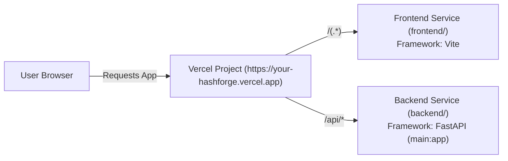

# HashForge: Production Deployment Guide

HashForge supports two deployment models:
1. **All-in-One Vercel Deployment (Vercel Services - Recommended):** Frontend in `frontend/` and FastAPI backend in `backend/` deployed together on **Vercel** under a single domain.
2. **Split Deployment (Alternative):** FastAPI backend on **Render** (persistent container) + React frontend on **Vercel** (static edge).

---

## METHOD 1: All-in-One Vercel Deployment (Vercel Services)

Vercel natively supports multi-service deployments via [`vercel.json`](../vercel.json):
- **Frontend Service:** Located in [`frontend/`](../frontend/) with framework `vite`.
- **Backend Service:** Located in [`backend/`](../backend/) with framework `fastapi` and entrypoint `main:app`.
- **Rewrites:** Routes `/api/(.*)` directly to `backend` and `/(.*)` to `frontend`.



### Advantages of Vercel Multi-Service
- **Clear Folder Boundaries:** Backend is 100% inside `backend/`, and frontend is 100% inside `frontend/`.
- **Zero CORS Issues:** Frontend and API share the exact same domain.
- **Zero Environment Variables Required:** Frontend communicates over relative `/api` paths.
- **Single Git Push:** Pushing to GitHub deploys both tiers atomically.

### Step-by-Step Deployment Instructions

1. **Push your repository to GitHub:**
   ```powershell
   git add .
   git commit -m "Configure Vercel multi-service for frontend and backend"
   git push origin main
   ```

2. **Import into Vercel:**
   - Log in to your [Vercel Dashboard](https://vercel.com/dashboard).
   - Click **Add New...** -> **Project**.
   - Select your **HashForge** GitHub repository.

3. **Configure Project Settings:**
   - **Project Name:** `hashforge` (or your chosen name)
   - **Framework Preset:** Leave as **Other** (the root `vercel.json` defines the `frontend` and `backend` services).
   - **Root Directory:** `./` (repository root).
   - **Environment Variables:** None required!

4. **Click Deploy:**
   - Vercel automatically builds both the `frontend` (Vite) and `backend` (FastAPI) services.
   - You will receive a single unified URL: `https://<your-project-name>.vercel.app`.

5. **Verify the Deployment:**
   - Visit `https://<your-project-name>.vercel.app`.
   - The top header will show `Backend: Operational` (with green status).
   - Check interactive Swagger documentation at `https://<your-project-name>.vercel.app/api/docs`.

---

## METHOD 2: Split Cloud Deployment (Render Backend + Vercel Frontend)

Use this method if you prefer a persistent, long-running Docker or Linux container on Render instead of serverless functions.

### Step 1: Deploy Backend to Render

1. Log in to [Render Dashboard](https://dashboard.render.com/).
2. Click **New +** -> **Blueprint**.
3. Select your repository. Render automatically reads [`render.yaml`](../render.yaml).
4. Click **Apply**. Render deploys:
   - **Build Command:** `pip install -r requirements.txt`
   - **Start Command:** `uvicorn backend.main:app --host 0.0.0.0 --port $PORT`
5. Copy your Render service URL (e.g., `https://hashforge-api.onrender.com`).

### Step 2: Deploy Frontend to Vercel

1. In Vercel, import the repository.
2. Set **Root Directory** to `frontend`.
3. Set **Framework Preset** to `Vite`.
4. In **Environment Variables**, add:
   - `VITE_API_BASE_URL` = `https://hashforge-api.onrender.com`
5. Click **Deploy**.

---

## Troubleshooting

### Vercel Serverless Function Limits
- Vercel free tier allows up to 10 seconds execution time per serverless request. HashForge's SHA-256 and SHA3-256 computations take under 50 milliseconds, well within limits.
- The 256-bit matrix calculations and 100-trial Monte Carlo simulations execute in pure Python in ~15 milliseconds.

### Client-Side Routing
The root [`vercel.json`](../vercel.json) rewrites all non-API paths to `frontend`:
```json
{
  "source": "/(.*)",
  "destination": { "service": "frontend" }
}
```
This ensures refreshing pages like `/single-bit-experiment` or `/algorithm-lab` will never return 404 errors.
